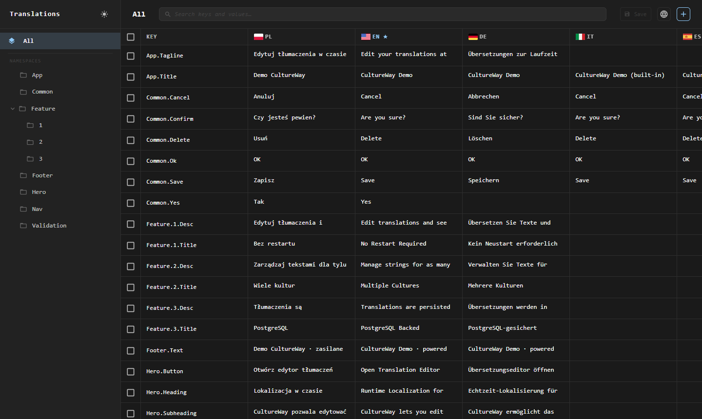
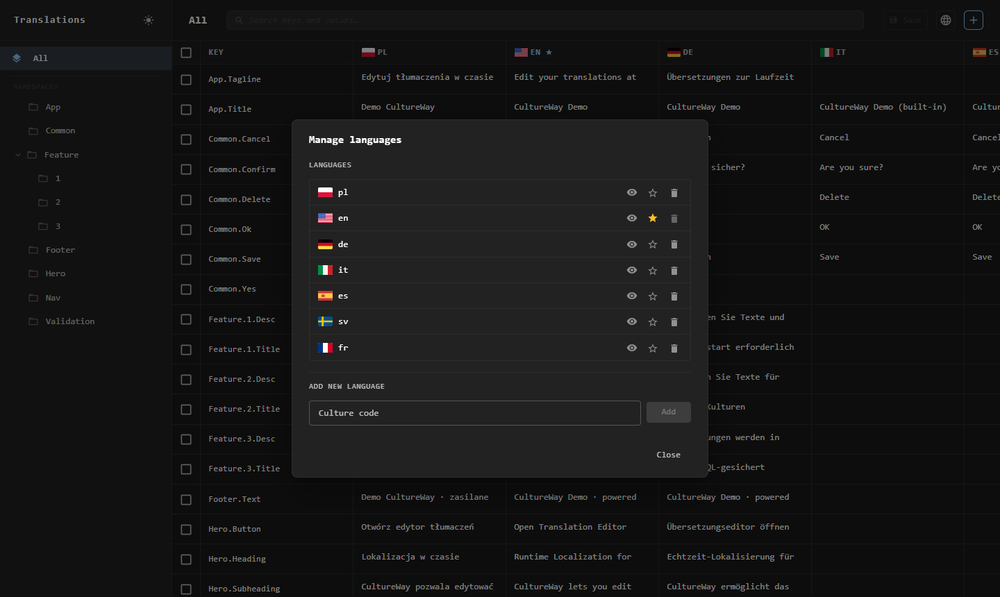
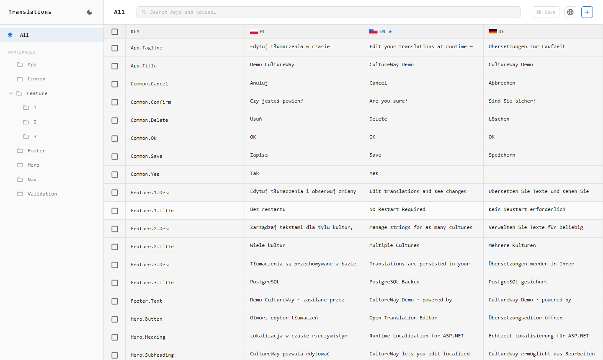

# CultureWay

[](https://github.com/kododo-dev/CultureWay/actions/workflows/ci.yml)
[](https://kododo.dev/cultureway/demo)

Runtime localization editor for ASP.NET Core. Translations are edited in a web UI built into your app and take effect immediately, without a rebuild or restart. Strings are resolved through the standard `IStringLocalizer`, so existing code keeps working.

A live demo is available at [kododo.dev/cultureway/demo](https://kododo.dev/cultureway/demo).

## UI







## Packages

| Package | NuGet | Description |
|---|---|---|
| `Kododo.CultureWay` | [](https://www.nuget.org/packages/Kododo.CultureWay) | Core DI registration, localizer, cache, in-memory store and `.resx` support |
| `Kododo.CultureWay.Core` | [](https://www.nuget.org/packages/Kododo.CultureWay.Core) | Abstractions (`IStore`, `IReadOnlySource`, `Translation`) for custom backends |
| `Kododo.CultureWay.UI` | [](https://www.nuget.org/packages/Kododo.CultureWay.UI) | Embedded web UI |
| `Kododo.CultureWay.PostgreSQL` | [](https://www.nuget.org/packages/Kododo.CultureWay.PostgreSQL) | PostgreSQL persistence store |

Targets `net8.0`, `net9.0` and `net10.0`.

## Quick start

```bash
dotnet add package Kododo.CultureWay.UI
dotnet add package Kododo.CultureWay.PostgreSQL  # optional, without it translations live in memory
```

```csharp
builder.Services.AddCultureWay(x =>
{
    x.Options.SupportedCultures = ["en", "pl", "de"];
    x.Options.DefaultCulture = "en";
    x.AddEditor();
    x.UsePostgreSQL(connectionString);
});

var app = builder.Build();

await app.InitializeCultureWayAsync();

app.UseRequestLocalization();
app.UseCultureWay("/translations"); // mounts the UI at /translations
```

Then use localization as usual:

```csharp
app.MapGet("/", (IStringLocalizer<Program> l) => l["Title"].Value); // Program.Title, then Title
```

`InitializeCultureWayAsync` creates the database schema, loads the translations into the cache and restores languages added at runtime.

## Keys and scopes

`IStringLocalizer<T>` looks keys up in the scope of `T`, the type's short name: in a `CheckoutPage`, `l["Pay"]` reads `CheckoutPage.Pay`. If that key has no value, it falls back to the unscoped `Pay`. Strings shared by many types can therefore stay without a scope, and each type can still override them. The editor shows scopes as namespaces in its side menu.

The user's language comes first. Each culture in the fallback chain is tried with both keys before the next culture, so an unscoped Polish `Pay` beats a scoped English `CheckoutPage.Pay` for a Polish user.

To choose a different scope, mark the type:

```csharp
[LocalizationScope("Shop.Checkout")]   // reads Shop.Checkout.Pay
public class CheckoutPage { }

[LocalizationScope("")]                // reads Pay, for a marker type of shared strings
public class SharedResources { }
```

| Option | Default | Description |
|---|---|---|
| `ScopeOf` | `CultureWayOptions.DefaultScopeOf` | Maps a type to its scope. The default reads `[LocalizationScope]`, or else uses the type's short name without the generic arity. |
| `FallBackToUnscopedKeys` | `true` | Whether a missing `{scope}.{key}` falls back to `{key}`. |

Localizers created from a base name instead of a type, such as `IViewLocalizer`, use the base name without the assembly name as the scope, e.g. `Views.Home.Index`.

## Languages

Languages can be added, deleted and set as default from the UI, and the store keeps them across restarts. Each browser can also hide languages it doesn't need. That only affects which columns the editor shows and is remembered in the browser's local storage.

Cultures added at runtime are also registered in ASP.NET Core's `RequestLocalizationOptions`, so the request localization middleware picks them up without a restart.

## `.resx` files

Existing resource files can be shown in the editor as a read-only baseline:

```csharp
builder.Services.AddLocalization(o => o.ResourcesPath = "Resources");

builder.Services.AddCultureWay(x =>
{
    x.UseResources<SharedResources>();
});
```

`UseResources<T>()` finds the files with the same naming convention as `IStringLocalizer<T>` and prefixes their keys with the scope of `T` (`SharedResources.Title`), which is where `IStringLocalizer<T>` looks them up. Pass `prefix: ""` to use the raw keys or any other string to choose your own.

A key that comes from `.resx` can't be deleted. You can override its value, and later reset it to the value from the resource file.

## Import and export

The editor exports and imports translations in two formats:

- **JSON**: one language per file, as a flat object (`{"Checkout.Pay": "Pay now"}`). Keys stay flat because `Checkout.Pay` and `Checkout.Pay.Tooltip` can both exist, which a nested object can't hold.
- **Excel (.xlsx)**: a `key` column followed by one column per language, e.g. `key | en | pl`.

An export can be limited to a namespace, or to the keys that have no value in one language, which is handy for sending work to a translator.

An import shows what it would change before anything is written. It adds and updates values and never deletes: keys missing from the file stay as they are. It can also add only missing values and leave existing ones alone. Rows it can't use and columns for languages the editor doesn't serve are listed and skipped. All changes are saved in one store call.

Everyone who can open the editor may import unless you set `CanImport` (see below). Files are limited to 5 MB; change it with `MaxImportBytes`.

## Security

Outside the Development environment the editor and its API answer `403` until you decide who may use them:

```csharp
app.UseCultureWay("/translations").RequireAuthorization("Admin");

// or, for a public demo:
app.UseCultureWay("/translations").AllowAnonymous();
```

A fallback authorization policy counts as a decision too. An editor nobody decided on is reported in the log at startup.

To let only some of the users who can open the editor add or delete languages, set `CanManageCultures` (see below). The others can still edit translations and hide languages, and the API answers their language changes with 403.

## Fitting the editor into your app

The editor runs in [Way.Shell](https://github.com/kododo-dev/WayShell), the UI shell shared by the Kododo Way libraries. The title, home link, language, links and signed-in user are the shell's settings, shared with every other Way in the app; with several Ways, the shell's panel shows them together:

```csharp
builder.Services.AddWayShell(o =>
{
    o.Title    = "My app";            // top of the side menu and the browser tab
    o.HomeUrl  = "~/";                // the title links here; "~/" is relative to the app
    o.Language = "pl";                // the interface language: en or pl; empty follows the browser
    o.Links.Add(new ShellLink("Home", "~/") { Icon = "home" });
    o.DynamicLinks.Add(ctx => ctx.User.IsInRole("Admin")    // links evaluated per request
        ? [new ShellLink("Users", "~/admin/users") { Icon = "users" }]
        : []);
    o.User     = ctx => ctx.User.Identity?.IsAuthenticated == true
        ? new ShellUser(ctx.User.Identity.Name!) { AccountUrl = "~/account", SignOutUrl = "~/logout" }
        : null;
});

app.UseCultureWay("/translations").RequireAuthorization("Admin");
app.UseWayShell("/admin").RequireAuthorization();   // optional: one panel with every Way
```

What only the editor needs stays in `AddEditor`:

```csharp
x.AddEditor(editor =>
{
    editor.CanManageCultures = ctx => ctx.User.IsInRole("Admin");
    editor.CanImport      = ctx => ctx.User.IsInRole("Admin");
    editor.MaxImportBytes = 1024 * 1024;
});
```

The settings that take an `HttpContext` run on every request, so they can depend on who is signed in. `EditorOptions.Title`, `HomeUrl`, `Language`, `Links` and `User` are obsolete; when set, they are passed on to the shell (`Links` to `ShellOptions.DynamicLinks`). The sign-out button submits a plain form POST to `SignOutUrl` without an antiforgery token, so that endpoint has to accept one.

The shell remembers the theme and the language in `localStorage` (`way-shell:theme`, `way-shell:language`). The selected namespace is in the address (`/translations/#/ns/Admin.Users`), so it can be linked to. When a request fails because the session expired (a 401, or a redirect to a sign-in page), the shell asks the user to sign in again in a new tab, so edits that were not saved stay on the page.

## Limitations

- An edit reloads the translations only in the instance that saved it. When the app runs as several replicas, the other replicas pick up the change after a restart.
- Values are formatted with `string.Format`. There is no plural or ICU message support, and a malformed placeholder such as `{0` throws when the string is used.

## Custom store

Implement `IStore` from `Kododo.CultureWay.Core` and register it before `AddCultureWay`. A minimal store needs `InitializeAsync`, `GetAllAsync`, `SetAsync` and `DeleteAsync`.

The members that deal with languages (`GetSupportedCulturesAsync`, `AddSupportedCultureAsync`, `RemoveSupportedCultureAsync`, `GetDefaultCultureAsync`, `SetDefaultCultureAsync`) have default implementations that do nothing. Override them if you want languages changed in the UI to survive a restart.

## Running the demo

```bash
cd src/CultureWay.UI/SPA && npm ci && npm run build
cd ../../..
dotnet run --project src/CultureWay.Demo.Web --framework net10.0
```

Without a `DemoDB` connection string the demo uses the in-memory store.

## Building from source

```bash
cd src/CultureWay.UI/SPA && npm ci && npm run build
cd ../../..
dotnet test src/CultureWay.Tests
dotnet test src/CultureWay.PostgreSQL.Tests  # needs Docker (Testcontainers)
```

## License

[MIT](LICENSE)
